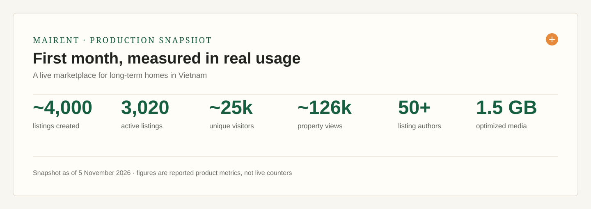
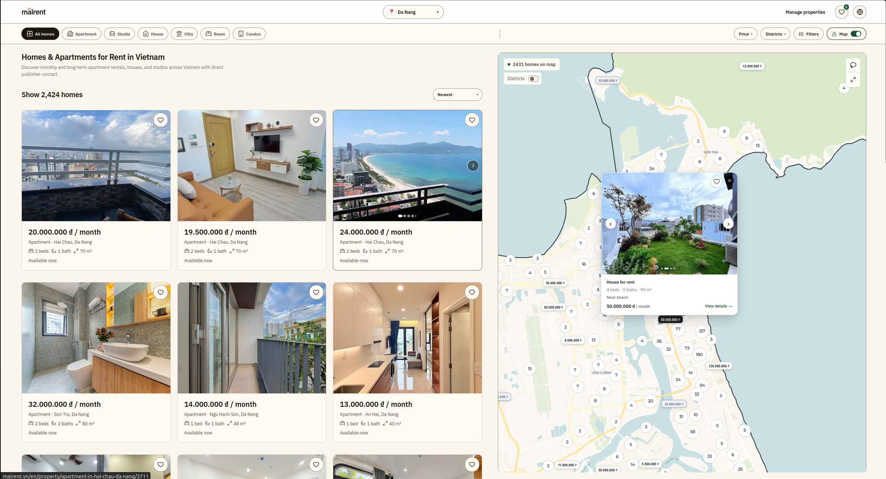
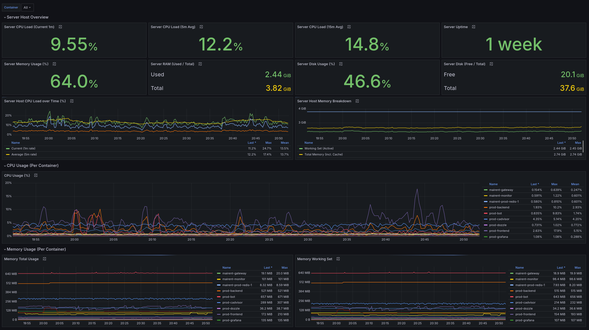
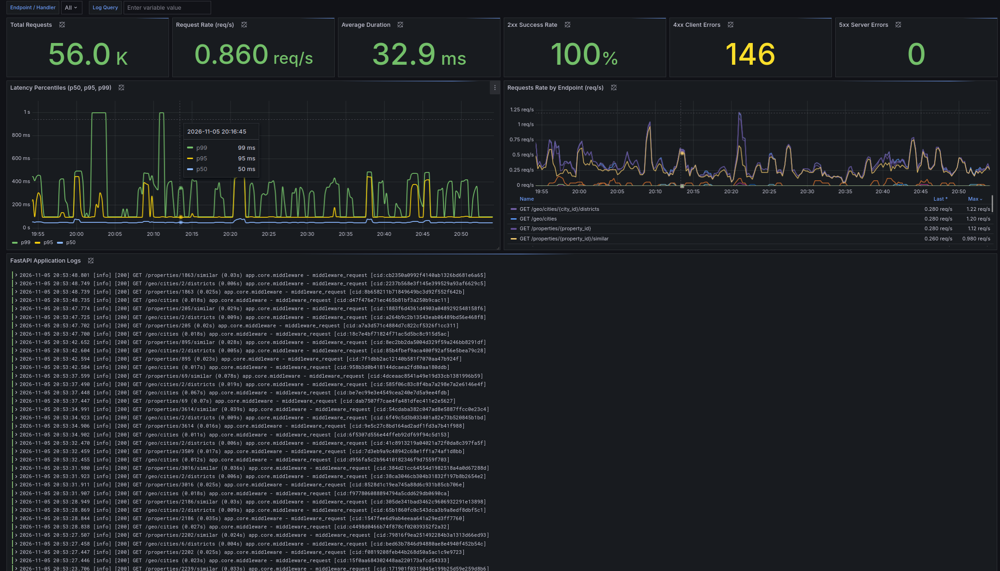
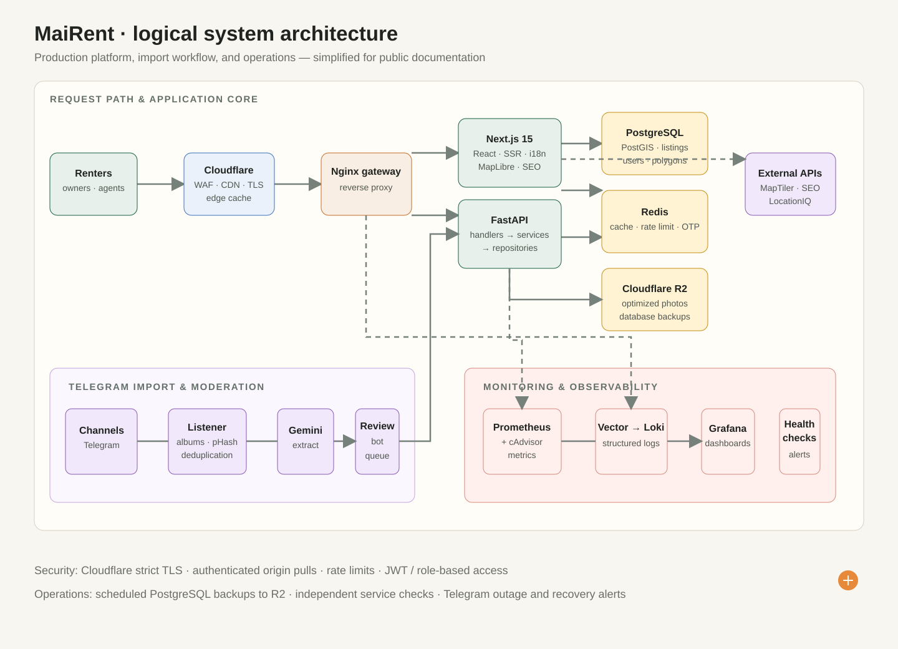

<h1 align="center">MaiRent</h1>

<p align="center">
  <strong>A production rental marketplace for long-term homes in Vietnam.</strong><br />
  Designed, built, and operated end-to-end by <a href="https://github.com/nikitayechshenko">Nikita Yechshenko</a>.
</p>

<p align="center">
  <a href="https://mairent.vn">Visit the live platform →</a>
</p>

<p align="center">
  
  
  
  
</p>

<br />

MaiRent helps renters find long-term apartments, houses, and studios throughout Vietnam — with rich filters, map-led discovery, direct contact with publishers, and no tenant commission. Property owners and agents can publish and manage listings, track their performance, and work through Telegram-assisted listing flows.

> This is a public technical portfolio for a live product. The application source and production configuration remain private.

## Production snapshot

<p align="center">
  
</p>

<p align="center"><sub>First month in production · snapshot dated 5 November 2026 · not live counters</sub></p>

## Product preview

### Homepage

<p align="center">
  
</p>

An editorial-style entry point that makes the value proposition, destination search, direct contact, transparent terms, and featured homes immediately clear.

### Map-led discovery

<p align="center">
  
</p>

Switch between an image-rich listing view and a spatial view powered by MapLibre, map tiles, listing clusters, and PostGIS-backed geospatial queries.

## Production observability

### Host & container health

<p align="center">
  
</p>

The infrastructure dashboard tracks host load, memory and disk capacity, uptime, and CPU and memory consumption for every production container.

### API performance

<p align="center">
  
</p>

FastAPI telemetry brings request volume, p50/p95/p99 latency, endpoint rates, error rates, and correlated application logs into one operational view.

## Architecture

<p align="center">
  
</p>

<p align="center"><sub>Logical architecture — a product overview, not a complete network topology.</sub></p>

The editable Mermaid source is available in [docs/architecture.md](docs/architecture.md).

## What is inside

| Area | Highlights |
| --- | --- |
| Discovery | Image-rich search, interactive maps, district polygons, map-area search, direct author contact |
| Publisher tools | Listing management, profile pages, performance analytics, verification and Telegram workflows |
| Frontend | Next.js 15, React 19, TypeScript, Tailwind CSS, TanStack Query, Zustand, MapLibre |
| Backend | FastAPI, SQLAlchemy async, Pydantic v2, PostgreSQL + PostGIS, Redis, Alembic |
| Media | Cloudflare R2, asynchronous S3-compatible access, Pillow optimisation and WebP conversion |
| Operations | Docker Compose, Nginx, Cloudflare, Prometheus, Vector, Loki, Grafana and Telegram alerts |

## Engineering notes

- **Geospatial search:** Listings, city boundaries, and district polygons use SRID 4326 geometry; the API supports radius, viewport, and containment queries.
- **Layered backend:** HTTP handlers focus on transport concerns; services hold business logic; repositories isolate persistence.
- **International by default:** English, Russian, and Vietnamese support with locale-aware routes and structured SEO metadata.
- **Efficient media:** Approximately 3,000 listings occupy about 1.5 GB of optimized media in Cloudflare R2 — roughly 500 KB per listing on average.
- **Production observability:** Container and application metrics, structured correlated logs, health checks, and Telegram-based outage/recovery alerts.

## Technology

```text
Frontend       Next.js 15 · React 19 · TypeScript · Tailwind CSS · MapLibre
Backend        Python 3.12 · FastAPI · SQLAlchemy 2.0 async · Pydantic v2
Data           PostgreSQL · PostGIS · Redis · Alembic
Storage        Cloudflare R2 · aioboto3 · Pillow · WebP
Infrastructure Docker Compose · Nginx · Cloudflare · Google Cloud VM
Observability  Prometheus · cAdvisor · Vector · Loki · Grafana · Dozzle
Integrations   Google OAuth · Telegram · LocationIQ · IndexNow · Google Indexing API
```

## Author

**Nikita Yechshenko** — solo developer and creator of MaiRent.

Explore the live platform at [mairent.vn](https://mairent.vn).
